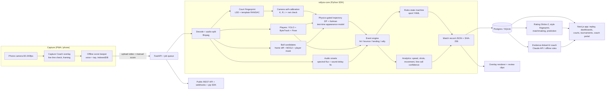

# AGENTS.md — RallyOS (Elevate 1.0, Problem Statement 02)

## Instructions for coding agents (read first)

This file is the single source of truth for the project. The product and build plan follows below.

**How to work in this repo**
1. **Build order is §12 (15-hour plan).** Work milestone by milestone. The **H8 end-to-end milestone** (upload → court → players → shuttle → rallies → dashboard on one clip) comes before any polish or ecosystem feature.
2. **Agree the data format first.** Define the `match.json` format (§11) before writing pipeline or UI code. The frontend works against a mock `match.json` until the pipeline produces real output.
3. **The vision code is a library.** All computer-vision logic lives in `core/rallyos/` as an installable package (`pip install -e core/`). `api/` is a thin FastAPI wrapper around it. Don't put CV logic in the API or web layers.
4. **No training, ever.** Use only pretrained general models (YOLO person/pose), geometry, physics and signal processing. Never add a training or fine-tuning step for a sport or venue. Sport differences go in `core/rallyos/sports/*.yaml`, not in `if sport == ...` branches.
5. **Every estimated number carries a confidence value.** Speeds have an error band. Line calls give a probability or "too close to call". Interpolated frames are flagged. Never present approximate results as exact (see §8).
6. **AI coach output must be grounded.** It may only cite numbers from the stats JSON, and every insight carries `stat_ids` and a `clip_t`. If there's no network, fall back to templated insights.
7. **Use the cut list (§12) when behind.** Never cut the end-to-end replay, the dashboard, or the multi-sport config demo.
8. **Keep the demo safe.** Write outputs from each pipeline stage to disk so a crash keeps partial results. Precompute demo outputs into `demo/`.
9. **Environment:** Windows 11. Python 3.11, Node 18+. Use paths that work on Windows. Download model weights ahead of time; don't depend on venue Wi-Fi.
10. **Testing:** unit-test the scoring rules for every sport and the court-template fitting (on computer-generated courts with a known H). Follow §20 to verify the full system.
11. **One machine, CPU first.** Everything runs locally on this laptop. Code must still run on CUDA too if a GPU is ever available: never hard-code `cuda`; pick the device with `rallyos.device.get_device()`.
12. **Keep the "Build status and next steps" section below current.** At the end of every work block, move finished items to done, record measured numbers, list new limits, and re-order the next steps. Never mark something done that has only been tested on generated data without saying so.

## Development setup: one laptop

All coding, processing, testing and the demo happen on this laptop, on CPU. There is no separate GPU machine and no remote worker.

| | **Laptop** |
|---|---|
| Writes | All code: `core/`, `api/`, `web/`, tests, seed data |
| Runs | Frontend (`npm run dev`), backend (`uvicorn`), unit tests, and the pipeline on uploaded clips |
| Python deps | `requirements.txt` (CPU build of torch) |
| Pipeline speed | About 2–2.7 × the clip length on CPU (measured on a 10 s 1080p clip; pose at 1280 px on the court area only, every 3rd frame; the automatic court search adds a few seconds). Keep demo clips short (10–60 s) and precompute them |

**How processing works**
- **Live:** the web upload page sends the video to the backend, which runs `rallyos.pipeline.Analyzer` in-process and streams progress.
- **Batch:** `python -m rallyos.pipeline <clip> --taps "[[x,y]*4]" --out demo/out/<clip>/`, then `python -m api.import_match demo/out/<clip>/`.
- **Videos and outputs:** never commit them to git (`.gitignore`: `demo/**/*.mp4`, `demo/out/`, `media/`, `models/`, `*.pt`). Share them through a cloud folder (Google Drive / OneDrive) when needed.
- **Speed levers:** `RALLYOS_MAX_WIDTH` (pose input size; 640 is about 3× faster but misses far-court players) and `--stride` (pose every N frames).

**Config / env vars:** `RALLYOS_DEVICE=auto|cpu|cuda`, `RALLYOS_MAX_WIDTH`, `RALLYOS_BALL_TRACKER`, `ANTHROPIC_API_KEY` (optional; coach falls back to templates). Keep them in `.env` (git-ignored) and commit a `.env.example`.

**Agent role (one Claude Code session)**
- **Builder agent (laptop):** owns all code, runs the pipeline and the app, writes `core/`, `api/`, `web/` and tests, and pushes to `main`.
- **No `.pkl` / model files are produced by us.** The only model files are downloaded pretrained weights (`yolo11n-pose.pt`, kept in `models/`). Ultralytics downloads them automatically on first use.
- **Windows note:** Smart App Control / Application Control can block freshly installed PyTorch DLLs. Don't try to bypass it; it usually clears after Windows checks the files. The pose stage also has an ONNX + OpenCV fallback (`models/yolo11n-pose.onnx`), and if neither loads the pipeline skips players and says so.

**Optional pretrained ball tracker: RacketVision (use as-is, never retrain)**
- **Source:** code at github.com/OrcustD/RacketVision (MIT), weights at huggingface.co/linfeng302/RacketVision-Models, dataset at huggingface.co/datasets/linfeng302/RacketVision. Paper: arXiv 2511.17045.
- **What we use:** the TrackNetV3 ball-tracking checkpoint `balltrack_best.pth`. It covers badminton, table tennis and tennis. Inference only. **Never** train or fine-tune it, and never train it on our own clips.
- **What we have:** precomputed predictions for the 46 badminton test clips (`demo/racketvision/`, git-ignored), imported with `python -m rallyos.track.plugins.racketvision build ...`. They are used as an alternative shuttle source and as the reference for measuring our geometric tracker.
- **Running it on new videos is optional and local:** it needs its own venv (`.venv-racketvision`, Python 3.10, torch 2.1.2) because it conflicts with our Python 3.11 / ultralytics environment, and on CPU it is slow. Set `RALLYOS_RACKETVISION_ROOT` and `RALLYOS_RACKETVISION_PY`, then `python -m rallyos.track.plugins.racketvision run <video> --out demo/out/<clip>/`.
- **What we skip:** the racket-pose models (RTMDet + RTMPose); we already get wrist positions from YOLO-pose.
- **When to use it:** badminton, TT, tennis can use the plug-in; pickleball, padel, squash use the geometric tracker only. Setting: `RALLYOS_BALL_TRACKER=auto|geometric|racketvision`.
- **Pitch slide:** compare the plug-in against the geometric tracker on our own phone footage. The model was trained on broadcast video, so it needs proving on amateur phone angles. Report both results honestly.

**Demo day:** present from the laptop using precomputed outputs in `demo/out/` (imported into the app). Run a live upload only with a short clip, since processing is on CPU.

---

## Build status and next steps (keep this section current: update it at the end of every work block)

Status key: ✅ done and verified · 🟡 built but only partly proven (see the note) · ❌ not built. Block names B1–B7 are the ones in §12.

### Where the build stands

| Block | Status | What exists |
|---|---|---|
| **B1 Foundation** | ✅ | Git, scaffold, `.gitignore`, `.env.example`, 6 sport YAMLs (court, net, projectile, scoring, shots, plus `audio`, `in_bounds`, `max_height_m`), mock `match.json` + `tracks.json`, `rallyos.device.get_device()`, YAML-driven scoring engine for all 6 sports (3 families) with tests |
| **B2 App shell** | 🟡 | FastAPI + SQLModel + SQLite: matches, rallies, events, tracks, disputes, players, coach, matchmaking, predict, courts, bookings, tournaments, sports, calibrate, videos (upload + SSE job progress), score confirm, recalibrate. Web: home, matches, match page, report, upload, disputes, players, coach, play, courts, tournaments, sports, developers. ❌ Missing pages: `capture`, `score` |
| **B3 Court + players** | ✅ | **Automatic Court Fingerprint** (`calibration/court_lines.py`, `court_fit.py`): line mask, line merging, rectangle hypotheses, per-sport template fit, sub-pixel refinement, sport detection, quality flag, draggable corners in the web UI; 4-tap fallback; camera self-calibration (focal length + camera position, `camera.py`); court regions of interest (`roi.py`: players and shuttle are only looked for on/around the court); YOLO11n-pose (ONNX fallback); player selector (static officials, court margins, size check); movement stats, live + whole-clip heatmap, zones |
| **B4 Shuttle + hits + rallies** | 🟡 | Geometric shuttle tracker (track F1 0.82 against RacketVision on 2 clips), tracklet linker, hit detection (F1 0.74), nearest-wrist hitter, rally segmentation, `api.import_match`, upload page with per-stage progress. 🟡 Audio onsets (`audio/onsets.py`) + audio/video fusion are built and unit-tested, but **no real clip with sound has been run yet** (all demo clips have no audio track) |
| **B5 Intelligence** | 🟡 | ✅ Landing detection → height-corrected court point → IN / OUT / TOO CLOSE with an uncertainty ellipse → suggested rally winner → score through the rules engine → Fair-Play Replay clips for calls under 90% → SHA-256 of the source video → evidence-linked coach (Claude with a number-grounding validator, template fallback). 🟡 IN/OUT is only proven on generated scenes: both calibrated real clips stop before the shuttle lands, so they correctly give no call. ✅ Speed with an error band by event timing (`analytics/speed.py`): average horizontal speed from a contact to the next contact or landing, hidden with a stated reason when an end is missing. ❌ Not built: flight-plane 3D peak speed (cut list), shot-type rules (§4.6), return-to-base / split-step / fatigue (§4.8) |
| **B6 Network** | 🔵 | Glicko-2 with evidence weights, matchmaking, explainable prediction, player / coach / play / courts / tournaments pages, all on seed data (logic is real, data is sample). ❌ Meetups |
| **B7 Multi-sport + SDK** | 🟡 | `pip install -e core/`, `developers` page, `sports` page with YAML viewer, RacketVision plug-in (precomputed results). The court fingerprint recognises all 6 templates on generated courts and found a real table-tennis table. 🟡 No full real run yet on tennis / pickleball / padel / squash video. ❌ `volleyball.yaml` stub |

Tests: `pytest` runs `core/tests` + `api/tests` (178 passing, about 1–2 minutes; the court-fit tests are the slow ones). The web app passes `tsc --noEmit`.

### Measured so far (honest numbers, for the pitch and Q&A)

| Metric (§14) | Target | Measured |
|---|---|---|
| Court calibration (automatic) | ≥ 90% of clips, under 5 px | On 4 broadcast badminton clips (1920×1080): 3 within 7 px of hand-checked corners (2 of them flagged "high quality"), 1 wrong on the far side (far baseline hidden behind the net tape) and correctly flagged "check". Table-tennis table found (flagged "check"). Auto-detect with taps given: 100% by definition |
| Sport detection | n/a | Correct on all 4 badminton clips and the table-tennis clip; generated courts: badminton, tennis, pickleball identified from inner lines |
| Shuttle track F1 vs RacketVision | recall ≥ 0.70 / precision ≥ 0.85 | recall 0.72, precision 0.94 |
| Hit detection F1 | ≥ 0.85 | 0.74 (vision only); audio fusion not yet measured on real sound |
| Processing speed | ≤ 2.5 × clip length | about 2.7 × on a 10 s, 25 fps, 1080p clip including automatic court detection (about 2 × with corners given) |
| Everything else in §14 | | not measured yet: no hand-labelled evaluation set exists |

### Known limits (state these openly)

- Doubles: one player per half is tracked, so a doubles clip reports only 2 of the 4 players.
- Side-on camera views (court length running across the image) are not proposed by the automatic fit; use the corner tool. Camera zoom or cuts inside a clip break a single calibration (typical of broadcast footage).
- Automatic court fit relies on the court lines being visible: a far baseline hidden by the net or by graphics gives a wrong far edge. The fit is flagged "check" when its precision is under 88%, and the corners can then be dragged. Without corners, the pipeline only applies a "high" fit.
- No line call or score on real footage until a clip runs until the shuttle lands. A shuttle lost against the net, still in the air, or at the end of the clip gets **no** call.
- Speeds are average horizontal speeds (a lower bound of peak speed: a high clear reads as ~15 km/h); shot types, return-to-base, split-step and fatigue are not computed, and the UI says so instead of guessing.
- Hit times from audio are only tested on generated clicks.

### Next steps, in order (each ends with tests, a commit and a push)

1. **Commit and push the current work** (court auto-detect, progress rework, heatmap/zones, outcome stage).
2. ✅ **Speed with an error band (§4.5, event timing)** is built. Left: run it on a clip with sound to see the audio-timed band (±1% timing instead of ±1 frame).
3. **Shot types by rules (§4.6).** Classify from the YAML thresholds (smash, clear, drop, net, lift, drive) using hit and landing zones, flight time and wrist height; every label carries a one-sentence reason.
4. **Movement intelligence (§4.8).** Return-to-base time, split-step %, fatigue curve; feed zones, speeds and shot mix to the coach with `stat_ids` and `clip_t`.
5. **Doubles support.** Track and name 4 players (clothing colour + side), per-player stats, scoring with `doubles=True`.
6. **Multi-sport proof on video.** Run one real table-tennis, one pickleball and one tennis clip through the automatic fit and the pipeline; fix what breaks; add `volleyball.yaml` as the "generalises" stub.
7. **Run a clip with sound** (and one that runs until the shuttle lands) to measure audio fusion and show a real IN/OUT call and dispute replay.
8. **Mobile / offline / voice (PS requirement).** `capture` page (framing guide), `score` page (offline score keeper, IndexedDB, voice scoring), then meetups if time allows (cut list items 4–5).
9. **Evaluation (§14).** Hand-label about 300 frames and 20 rallies (for measurement only), add the evaluation script, fill the metrics table above.
10. **Freeze (§12 13–14 h).** Precompute every demo clip into `demo/out/`, import, record the backup demo video, rehearse §13.

Never cut: the end-to-end replay, the match dashboard, the multi-sport config demo. Cut list order is unchanged (§12).

---

# RallyOS — Racket-Sports Intelligence from One Camera
### Product + 15-hour hackathon build plan (Problem Statement 02, Elevate 1.0)

> **Assumptions** (change any that are wrong):
> - **One laptop, one Claude Code builder session.** The 4 team members share this laptop and rotate the human roles in §12. Only this one session writes code, so the build plan runs in order rather than in parallel.
> - The laptop has no usable GPU and there is no cloud GPU: everything is processed locally on CPU, so demo clips are kept short and precomputed.
> - You're allowed to bring pre-recorded video.
> - **Badminton** is the main demo sport. It matches the reference image and is a very large grassroots sport in India.
> - Repo: https://github.com/ELEVATE-1-0/ELEV02 (`main` branch).

---

## 0. Context: why this plan looks the way it does

The problem asks: *"How much of a professional tracking system can be rebuilt from one normal camera, across racket sports, with no training, while also connecting players?"*

Most teams will build one of two things:
- a badminton tracker that only works on their own clip, or
- a booking app with an "AI" label on it.

Judges have seen both many times. To win, you need:
- one technical core that clearly works on real video, and
- a clear reason why that core makes the rest of the ecosystem valuable.

**Strategic thesis:** *the camera isn't the product. The verified match record is.*

A single phone turns any match into a **trusted, structured data record**. That record feeds verified ratings, coaching, matchmaking, tournaments and venue value. Today, companies either own the camera (Hawk-Eye, PlaySight) or own the community (booking apps). Nobody connects the two at grassroots level.

---

## 1. Name, tagline, one-line pitch

- **Name:** **RallyOS** (backups: CourtSense, OneCourt). Check trademark and domain availability before using it commercially.
- **Tagline:** *"One phone. Any court. Every rally counted."*
- **One-liner:** RallyOS turns any smartphone into a match analyst that calibrates itself and needs no training, across six racket sports. Every recorded match becomes a verified record that feeds ratings, coaching, matchmaking and tournaments.

---

## 2. Problem and user pain points (who pays and why)

| User | Pain today | What RallyOS gives them | Will they pay? |
|---|---|---|---|
| **Club/academy player** | No stats, no record, no objective sense of their level | Automatic stats, highlights, verified rating, AI coach | Free tier, then Pro |
| **Coach / academy** | Watches 30 kids with no data; progress is anecdotal; parents ask "is my child improving?" | Per-player dashboards, trend reports, progress cards parents can see | **Yes. This is the first paying customer** |
| **Venue / court owner** | Empty off-peak slots, nothing that sets them apart | "Smart Court" badge, bookings, automatic highlight reels for social media | Yes (subscription + booking commission) |
| **Tournament organiser** | Paper score sheets, disputes, manual draws, no results archive | Automatic or assisted scoring, live score page, dispute replays, digital draws, ranking feed | Per-event fee |
| **District/state association** | No reliable grassroots rankings | Ranking system built on verified matches | License |
| **Developer / partner** | No affordable computer-vision API for racket sports | SDK + REST API + sport config format | Pay per use |

---

## 3. Three solution concepts, then the pick

| | **A. RallyOS: Verified Match Graph** | **B. Dispute Desk** | **C. Pose-First Footwork Coach** |
|---|---|---|---|
| Core idea | One phone → tracking that calibrates itself → verified match record → rating, coach and matchmaking network | Tournament tool: assisted scoring + replay evidence for close calls | Footwork and movement coaching from body pose only (no ball needed) |
| Target | Players, coaches, venues, organisers | Organisers, umpires | Coaches, academies |
| Different because | Multi-sport vision with no training, **plus** a data network that uses it | Shows confidence levels instead of pretending to be an official line-calling system | Works even when the ball can't be tracked |
| Feasibility (15h) | Medium. Core is real; ecosystem runs on sample data | High | High |
| Long-term advantage | Network effect of verified data + saved venue calibrations | Weak (a feature, not a platform) | Weak on its own |
| Impact | Whole ecosystem | Tournaments only | Training only |

**Pick: A, with B and C built in as modules.**
- B becomes the *Fair-Play Replay* feature.
- C becomes the *Movement Intelligence* metrics.

That way the demo shows real computer-vision depth and a product story. Each module is also something a paying customer could buy on its own.

---

## 4. The core innovation: 10 training-free techniques

Everything below uses only:
- pretrained general models (person detection, body pose),
- geometry,
- physics,
- signal processing.

Nothing is trained or fine-tuned for a specific sport or venue. Adding a sport means adding one config file (YAML).

### 4.1 Court Fingerprinting: detects the sport *and* calibrates the camera
1. **Find the court lines.** Use a white/yellow top-hat filter, an adaptive threshold and OpenCV's line segment detector (`createLineSegmentDetector`).
2. **Find the corners.** Group the line segments into two main directions and intersect them to get candidate line junctions.
3. **Try every sport's court layout.** Fit each sport's court template (from the configs) to the junctions using RANSAC. Score each fit by how far off the projected lines are (reprojection error) and how much of the visible lines it covers.
4. **Pick the best fit.** The lowest-error template wins, e.g. *"Badminton detected, 96% fit"*. This also gives the homography **H**, which maps image pixels to court positions in metres.
5. **Detail judges will appreciate:** badminton (13.40 × 6.10 m) and pickleball (13.41 × 6.10 m) have almost the same outline.
   - Badminton has a doubles long-service line 0.76 m inside the baseline, plus inner singles sidelines.
   - Pickleball has neither, but has a kitchen line 2.13 m from the net.
   - Matching only the outline would fail here. Matching the inner lines works.
6. **Fallback:** the user taps the 4 court corners (about 10 seconds). Always available, always works.
7. **Saved venue profiles:** the calibration is stored per court, so a "Smart Court" is ready instantly on the next visit.

### 4.2 Camera that calibrates itself (no checkerboard)
- **Estimate the focal length** from the court homography alone. This uses Zhang's single-plane method and assumes square pixels and a centred image centre. From that you get the full camera position and angle, `P = K[R|t]`.
- **Sanity-check with the known net height** from the config (badminton 1.524 m at centre, tennis 0.914 m, table tennis 0.1525 m, pickleball 0.86 m, padel 0.88 m). The top of the net should appear where the camera model predicts.
- **Camera shake:** match ORB features to a reference frame and recompute H every few frames. This handles hand-held phones and wobbly tripods.

### 4.3 Physics-checked ball/shuttle tracking (no trained ball detector)
Don't assume YOLO will reliably detect a 4 cm blurred ball. It won't. Instead:
1. **Find candidates.** Look for small things that moved, using three-frame differencing (`|I_t − I_{t−1}| ∧ |I_{t+1} − I_t|`) and MOG2 background subtraction. Only search the court and the air above it.
2. **Mask out the players.** Blank out slightly enlarged YOLO person boxes. This removes most false detections (arms, rackets).
3. **Check the size.** From H, the camera position and the ball diameter in the config, compute how many pixels the ball should be at each spot in the image. Reject blobs of the wrong size.
4. **Choose the most physically plausible path.** Over a sliding window of frames, use dynamic programming (Viterbi) to pick the chain of candidates that best fits the sport's motion model from the config:
   - **Balls:** a normal throw arc with light air drag; bounces allowed.
   - **Shuttle:** strong air drag (it tops out at about 6.7 m/s when falling), which gives the steep drop after the high point; no bounce.
5. **Fill the gaps.** A Kalman filter plus the physics model fills frames where the shuttle is hidden or blurred. Those frames are marked as *interpolated* with lower confidence.
6. **Adapt to the venue on the fly (no model training).** After about 50 confident, physics-confirmed detections, build a colour and size profile of *this* ball under *this* lighting, and use it to score new candidates. The system adapts to the venue without labels or training.
7. **Optional plug-in:** an existing pretrained tracker for one sport (e.g. TrackNetV3 for badminton). Use it only if available, and *never fine-tune it*. The geometry-based pipeline stays the default, so the "no training" claim holds for any new sport.

### 4.4 "Hear the Rally": combining sound and video to detect hits (biggest underrated trick)
- **Hits make a sharp sound.** A standard onset detector (spectral flux, numpy only) finds them with no training, and the same method works for every sport.
- **Sound gives much better timing.** Audio is sampled 44,100 times a second, versus 30–60 video frames a second. So hit times are accurate to about **1 ms instead of 16–33 ms**.
- **Correct for the speed of sound** (few teams will think of this). A hit 13 m from the camera reaches the microphone about 38 ms late. Subtract `distance(hitter, camera) / 343`, using the hitter's court position from H.
- **Confirm hits using both signals.** A hit counts when a sound spike lines up with the shuttle changing direction near a player's wrist. When the shuttle is lost, sound alone still counts hits, so rally length stays reliable.
- **Who hit it:** the player whose wrist is closest to the point where the shuttle changed direction.

### 4.5 Speed estimation: event timing (robust) + flight-plane 3D (advanced)
- **Average speed (robust):** distance from hit point to landing point on the court, divided by (landing time − hit time from audio). Both points come from the homography and body pose, so this works **even if the shuttle is invisible in mid-flight**.
- **Flight-plane 3D reconstruction:** between two hits, the shuttle travels roughly in a vertical plane through the hit point and the landing point.
  - Turn each 2D detection into a ray from the camera.
  - Intersect the ray with that plane.
  - This gives a 3D trajectory, the maximum height, and peak speed.
- **Show speeds with an error band**, e.g. "≈ 182 km/h ± 15%", never with false precision. At 30 fps a smash moves several metres per frame. So the capture guide recommends 60–240 fps slow-motion, which most modern phones support.

### 4.6 Explainable shot classification (rules, not a trained classifier)
**Inputs:**
- where the shot was hit from,
- where it landed,
- how long it was in the air,
- how high it went above the net,
- whether the wrist was above the head (from body pose).

**Badminton examples:**
- **Smash:** overhead, steep, short flight.
- **Clear:** very high, lands in the back court.
- **Drop:** from the back court to the front court, slow.
- **Net shot:** front court to front court.
- **Lift:** from the front court to the back court.
- **Drive:** flat, mid-court, fast.

Each sport's thresholds live in its config file. Every label can be explained in one sentence, which judges like.

### 4.7 Line calls with confidence + Fair-Play Replay (dispute evidence)
- **Measure the uncertainty.** Project the landing or bounce point onto the court. Combine the sources of error (detection noise, calibration error, interpolated frames) into an **uncertainty ellipse** drawn on the court.
- **Give an honest call:** **IN (91%)**, **OUT (88%)**, or **TOO CLOSE TO CALL**. Never fake certainty.
- **Close calls automatically get a review package:**
  - a 6-second clip (3 seconds either side),
  - slow motion,
  - the trajectory drawn on the video,
  - a top-down court view showing the ellipse.
- **Tamper-evident record:** store a SHA-256 hash (a digital fingerprint) of the source video and event log with the match. A "verified match" can then be checked later. This is what makes grassroots rankings trustworthy.

### 4.8 Movement Intelligence (from body pose, works for any sport)
Uses pretrained body-pose keypoints (YOLO-pose / RTMPose), with each player's feet mapped onto the court:
- **Court coverage heatmap**, distance covered, and top movement speed.
- **Return-to-base time:** how long the player takes to get back to the centre (or the T in squash) after each shot. This is a key coaching metric in badminton and squash.
- **Split-step detection:** both ankles lift together within 300 ms before the opponent hits. Report the % of opponent shots where the player split-stepped.
- **Fatigue curve:** how movement speed and recovery time drop over the match.
- **Reach / lunge depth** in the front court.

### 4.9 AI coach that cites evidence (no made-up numbers)
- **Grounded input only.** The language model receives just the computed stats file (JSON).
- **Every claim must cite its source:** a stat ID and a video timestamp.
- **A validator** rejects any number that isn't in the stats file.
- **Every insight is clickable** and jumps to the exact moment in the video. Example: *"Your return-to-base time rose from 1.1 s to 1.6 s after rally shot 8 → endurance, not technique. [watch 3 examples]"*
- **Extras:**
  - a drill library linked to each weakness,
  - an optional **voice read-out** (browser speech API) for use courtside,
  - an **offline fallback** of rule-based, templated insights when there's no network.

### 4.10 Verified rating + playing-style matchmaking
- **Rating:** Glicko-2 (a chess-style rating system), with matches verified by video moving the rating more than self-reported ones. This links the camera directly to the trust in the network.
- **Style fingerprint** for each player:
  - how often they attack,
  - average rally length,
  - % of play at the net,
  - % of play in the back court,
  - smash rate,
  - how much they move.
- **Matchmaking:** players with a similar rating, nearby and available, ranked by how well their styles complement each other ("find someone who will test your defence").
- **Explainable prediction:** a simple model using rating difference, style matchup and past head-to-head results. It shows the top 3 factors behind each prediction.

---

## 5. Multi-sport generalisation

**Shared core (same code for every sport):**
- video input/output,
- court line detection + template fitting,
- camera self-calibration,
- person detection, tracking and pose,
- ball candidate search,
- trajectory path-finding,
- audio hit detection,
- event rules,
- scoring state machine,
- analytics,
- video rendering,
- API.

**Sport layer (config only, no code):**
- court template (lines and zones in metres),
- net and wall geometry,
- ball physics (diameter, motion model, bounce yes/no, speed range),
- which events exist,
- scoring rules,
- shot-type thresholds,
- camera setup recommendations.

| Sport | Court (m) | Ball / shuttle | Motion model | Notes |
|---|---|---|---|---|
| Badminton | 13.40 × 6.10 | Shuttle | Strong drag, no bounce | Rally point to 21, win by 2, cap at 30 |
| Tennis | 23.77 × 10.97 | 6.7 cm ball | Throw arc + bounce | Game/set/tiebreak; far camera, so the ball is smallest in the image |
| Table tennis | 2.74 × 1.525 (table) | 4 cm ball | Throw arc + bounce, very fast | The "court" is the table; side view preferred; 11 points, serve changes every 2 |
| Pickleball | 13.41 × 6.10 | Perforated ball (slower) | Throw arc + bounce | Kitchen line; side-out or rally scoring as an option |
| Padel | 20 × 10 | Ball | Throw arc + bounce + **wall rebounds** | Glass walls become extra planes in the template |
| Squash | 9.75 × 6.40 | Small ball | Bounce + **front wall** | Camera behind the back wall; front-wall template (tin 0.48 m, out-line 4.57 m) |

**Sample config: `sports/badminton.yaml`**
```yaml
sport: badminton
court:
  units: m
  length: 13.40
  width: 6.10                # doubles
  lines:                     # court coordinates, origin = near-left corner
    - {id: baseline_near,      p1: [0, 0],      p2: [6.10, 0]}
    - {id: long_service_dbl_n, p1: [0, 0.76],   p2: [6.10, 0.76]}
    - {id: short_service_n,    p1: [0, 4.72],   p2: [6.10, 4.72]}
    - {id: net,                p1: [0, 6.70],   p2: [6.10, 6.70]}
    - {id: singles_left,       p1: [0.46, 0],   p2: [0.46, 13.40]}
    # ... mirrored far half
  base_position: [3.05, 3.4]   # used for return-to-base metric
net: {height_center: 1.524, height_post: 1.55}
projectile:
  kind: shuttle
  size_m: 0.065
  motion_model: quadratic_drag
  terminal_velocity_mps: 6.7
  bounces: false
  color_prior: [white, yellow]
events: [serve, hit, landing, net_touch, fault]
scoring:
  type: rally_point
  points_to_win: 21
  win_by: 2
  cap: 30
  games_to_win: 2
  serve_rule: winner_serves
shots:   # explainable rule thresholds
  smash: {wrist_above_head: true, max_flight_s: 0.6, descent_deg_min: 25}
  clear: {land_zone: rear, apex_over_net_m_min: 3.0}
capture: {min_fps: 60, recommended_fps: 120, camera: "behind baseline, 2-3 m high, centred"}
```

**Adding a new sport or venue with zero training:**
1. Write the YAML file (court lines, ball, scoring).
2. Court Fingerprinting automatically includes the new court layout.
3. The first upload at a venue calibrates itself, through the fingerprint or 4 taps.
4. Done.

**Beyond racket sports:** the same building blocks (court layout + ball physics + event rules + scoring rules) cover volleyball, sepak takraw, futsal and basketball shot tracking. Show a `volleyball.yaml` stub on the "generalises" slide.

---

## 6. System architecture



**Key decision:** build the vision code as an installable Python package (`rallyos-core`) from hour 1. FastAPI is only a thin layer on top. This means **the SDK comes for free**, and the bonus point is real rather than just a slide.

---

## 7. AI/ML pipeline: input → processing → output

| Stage | Input | Method (training-free?) | Output |
|---|---|---|---|
| Ingest | MP4 video with audio | ffmpeg; shrink frames to 960 px for detectors, keep full resolution for the ball search area | Frames, 44.1 kHz audio |
| Court | First ~30 frames (combined) | Line detection + template fitting (**pure geometry**) | Sport guess, H, fit error |
| Camera | H + net height from config | Focal length from the homography (**geometry**) | Camera parameters (K, R, t) |
| Players | Frames | YOLO person detector (**pretrained, not fine-tuned**) + ByteTrack + clothing-colour matching | Player tracks, court positions |
| Pose | Player crops | YOLO-pose / RTMPose (**pretrained**) | 17 body keypoints per player |
| Ball | Frames, player masks | Motion detection + size check + path-finding + Kalman (**classical methods + physics**) | 2D track, confidence, 3D path (flight plane) |
| Audio | Sound | Onset detection (**signal processing**) | Hit timestamps |
| Events | All of the above | Combination rules + event rules from YAML | Hits, landings, rallies, who hit |
| Scoring | Events | Scoring rules from config + human confirmation | Live score |
| Analytics | Events + tracks | Fixed formulas | Stats file, shots, speeds, line calls |
| Coach | Stats file | Language model + citation check (**no training**) | Insights + clip links |
| Network | Match records | Glicko-2, style similarity, simple prediction model | Rating, opponent suggestions, predictions |

**Limitations to state openly (judges reward honesty):**
- motion blur at 30 fps (a smash is a streak or invisible),
- players and the net hiding the ball,
- the tiny far-court ball in tennis,
- LED light flicker at high frame rates,
- bright windows behind the court,
- low camera angles that flatten depth,
- players who look alike in doubles.

**Mitigations:**
- Capture Coach framing guidance,
- high frame rates,
- sound filling in missed hits,
- physics filling gaps,
- confidence scores on every number,
- human confirmation of scores.

---

## 8. What's real in the demo (honesty matrix)

| Tier | Features |
|---|---|
| ✅ **Real video processing (reliable)** | Court Fingerprint + homography (4-tap fallback), player detection and tracking, body pose, heatmaps / distance / coverage, sound-based hit detection, rally detection, rally length, hit counts, replay with overlays, scoring rules (all 6 sports), post-match dashboard, AI report with evidence links |
| 🟡 **Real but approximate (shown with confidence)** | Shuttle trajectory (gaps filled), speed (± band), shot type, in/out with confidence, suggested rally winner (human confirms), split-step, return-to-base |
| 🔵 **Real logic on sample data** | Ratings (Glicko-2 runs live), matchmaking, explainable predictions, courts and booking (payment mocked), tournaments and draws, coach roster, meetups |
| 🔴 **Research / needs better hardware (roadmap only)** | Officiating-grade line calls, spin, exact peak smash speed at 30 fps, full real-time processing on the phone, multi-camera 3D, live broadcast overlays |

---

## 9. Tech stack

| Layer | Choice | Why |
|---|---|---|
| Vision / ML | Python 3.11, OpenCV, `ultralytics` (YOLO11n + pose), `supervision` (ByteTrack, drawing tools), NumPy/SciPy, `filterpy`, ffmpeg (bundled via `imageio-ffmpeg`) | All install with pip, pretrained models included, fast to build with |
| Backend | **FastAPI** + simple in-process job queue (product: Celery/RQ + Redis), live progress updates (server-sent events) | Fast to build; automatic API docs double as SDK docs |
| Database | SQLite (via SQLModel) for the hackathon → Postgres (Supabase) for the product | No setup now, easy to migrate later |
| Storage | Local disk → S3 / Cloudflare R2 | |
| Frontend | **Next.js + Tailwind + shadcn/ui + Recharts**, with an HTML5 `<canvas>` overlay synced to the video (`requestVideoFrameCallback`) | Polished UI quickly; interactive overlays |
| Mobile / offline | Installable web app (PWA): offline score keeper (IndexedDB), voice scoring through the browser speech API ("point blue"), upload later when online | Works courtside with poor network |
| Language model | Claude API: `claude-haiku-5-5` for quick insights, `claude-sonnet-5-5` for the full report; offline fallback = template rules | Grounded write-ups; works offline |
| Login | Supabase Auth or simple JWT (demo: preset users) | |
| Hosting | Hackathon: everything local on the laptop. Product: frontend on Vercel, vision processing on rented GPUs, Docker image | Phone-side processing later removes most compute cost |

**Speed target:** on the laptop CPU, a 30-second clip in about a minute (pose at 1280 px every 3rd frame); on a GPU, a 2-minute clip in 3 minutes or less.
- Run YOLO on every frame at 960 px.
- Run pose on every 2nd frame.
- Search for the ball at full resolution, but only in the court area.
- On CPU only, precompute the demo clips.

---

## 10. Data model and API

**Core tables:**
- `users`
- `players(id, user_id, rating, rd, vol, style_vec, home_venue)`
- `venues`
- `courts(id, venue_id, sport, calibration_json, smart_court bool)`
- `matches(id, sport, court_id, p1..p4, status, score_json, evidence_level[self|assisted|video_verified], video_url, sha256)`
- `rallies(id, match_id, idx, t_start, t_end, hits, winner, end_reason, confidence)`
- `events(id, rally_id, t, type, player_id, court_x, court_y, speed_kmh, speed_err, confidence, interpolated)`
- `disputes(id, event_id, clip_url, call, prob, status)`
- `insights(id, match_id, player_id, text, stat_ids, clip_ts)`

**Ecosystem tables:** `bookings`, `tournaments`, `registrations`, `draw_matches`, `coach_players`, `meetups`, `rating_history`.

**Frame-by-frame tracking data:** stored as one Parquet/JSON file per match, not as database rows.

**REST API (`/v1`, also the SDK surface):**
```
POST /calibrate                 frame (+ optional 4 taps) → sport, H, K, fit_error
POST /videos                    upload → job_id
GET  /jobs/{id}                 progress (SSE)
GET  /matches/{id}              summary, score, evidence level, sha256
GET  /matches/{id}/rallies | /events | /tracks
GET  /matches/{id}/report       evidence-linked coach report
POST /matches/{id}/score/confirm   human-in-the-loop correction
GET  /disputes/{id}/clip
GET  /players/{id} | /players/{id}/trends
GET  /matchmaking?player_id=&radius_km=
GET  /predict?a=&b=             win prob + top factors
GET  /courts?near= ; POST /bookings
GET  /tournaments ; POST /tournaments/{id}/register ; POST /tournaments/{id}/draw
GET  /sports ; POST /sports      list / register a sport YAML
Webhooks: match.processed, dispute.flagged, rating.updated
```

**SDK:**
```python
from rallyos import Analyzer
m = Analyzer(sport="auto").run("match.mp4")
print(m.sport, m.score, m.rallies[0].hits, m.player("A").heatmap)
m.export("match.json"); m.render("overlay.mp4")
```

**Error handling:**
- **Calibration fails:** ask the user to tap the 4 corners.
- **Ball tracking confidence is low:** hide speed and show "insufficient tracking".
- **Processing job crashes:** results are saved after each stage, so partial results survive.
- **Every number** carries a confidence value.

---

## 11. Folder layout to create (`EL02/`)

```
EL02/
  core/rallyos/                 # pip-installable SDK
    sports/*.yaml               # badminton, tennis, table_tennis, pickleball, padel, squash
    calibration/{court_lines.py, template_fit.py, camera.py, stabilize.py}
    detect/{players.py, pose.py, ball_candidates.py}
    track/{ball_dp.py, kalman.py, appearance.py, player_reid.py}
    audio/onsets.py
    events/{hits.py, landings.py, rallies.py}
    rules/engine.py             # generic state machine driven by YAML
    analytics/{speed.py, shots.py, movement.py, linecall.py, stats.py}
    render/{overlay.py, clips.py}
    pipeline.py                 # Analyzer
  api/                          # FastAPI app (detailed below)
  web/                          # Next.js app (detailed below)
  data/seed/                    # players, venues, tournaments, past matches
  demo/                         # clips + precomputed outputs (safety net)
  docs/                         # pitch deck, architecture, API docs
```

**Agree the shared data format first (hour 0):** the `match.json` format, with these fields:
- sport,
- calibration,
- players,
- a reference to the tracking file,
- rallies,
- events,
- score,
- stats,
- disputes.

The frontend builds against a mock version of this file from the start, so nobody waits on anyone.

### 11.1 Backend layout: `api/` (FastAPI + SQLModel + SQLite)

```
api/
  main.py                 # FastAPI app, CORS (allow http://localhost:3000), mounts routers, serves /media
  config.py               # reads .env: DATABASE_URL, MEDIA_DIR, RUNTIME_DIR, ANTHROPIC_API_KEY
  db.py                   # engine, session dependency, create_all()
  models.py               # SQLModel tables from §10 (users, players, venues, courts, matches, rallies,
                          #   events, disputes, insights, bookings, tournaments, registrations, meetups, rating_history)
  schemas.py              # Pydantic response models; MatchJSON mirrors the match.json format below
  routers/
    calibrate.py          # POST /v1/calibrate
    videos.py             # POST /v1/videos (upload), GET /v1/jobs/{id} (SSE progress)
    matches.py            # GET /v1/matches, /v1/matches/{id}, /rallies, /events, /tracks, POST /score/confirm
    disputes.py           # GET /v1/disputes/{id}, /clip
    players.py            # GET /v1/players, /v1/players/{id}, /trends
    coach.py              # GET /v1/matches/{id}/report
    network.py            # GET /v1/matchmaking, GET /v1/predict
    courts.py             # GET /v1/courts, POST /v1/bookings
    tournaments.py        # GET /v1/tournaments, POST /register, POST /draw
    sports.py             # GET/POST /v1/sports (reads core/rallyos/sports/*.yaml)
  services/
    jobs.py               # in-process job queue; runs rallyos.Analyzer locally and imports the result
    importer.py           # loads demo/out/<clip>/ (match.json, overlay.mp4, clips) into the DB
    rating.py             # Glicko-2 + evidence multiplier
    matchmaking.py        # style-vector similarity + rating window + distance
    predict.py            # logistic win probability + top-3 factors
    coach.py              # Claude API call + citation validator + offline template fallback
  import_match.py         # CLI: python -m api.import_match demo/out/<clip>/
  seed.py                 # CLI: python -m api.seed  (loads data/seed/*.json)
  tests/                  # pytest: rating, matchmaking, importer, routers (TestClient)
media/                    # git-ignored: uploaded videos, overlays, dispute clips (served at /media)
```

**Run:**
```
pip install -r requirements.txt
python -m api.seed
uvicorn api.main:app --reload --port 8000     # docs at http://localhost:8000/docs
```
**Rule:** routers stay thin; logic lives in `services/` or `core/rallyos`. Until the real pipeline exists, `GET /v1/matches/{id}` serves `data/mock/match.json`.

### 11.2 Frontend layout: `web/` (Next.js App Router + TypeScript + Tailwind + shadcn/ui + Recharts)

```
web/
  app/
    layout.tsx              # nav sidebar, dark/light theme
    page.tsx                # Home: recent matches, "Analyse a match" CTA
    upload/page.tsx         # upload video, pick sport (or auto), 4-tap calibration fallback, job progress (SSE)
    matches/page.tsx        # match list
    matches/[id]/page.tsx   # MATCH VISION: video + canvas overlay, mini-court, score, rally timeline + waveform, stats tabs
    matches/[id]/report/page.tsx     # AI coach report; each insight links to clip time
    disputes/[id]/page.tsx  # FAIR-PLAY REPLAY: slow-mo clip, trajectory, uncertainty ellipse, IN/OUT %, sha256 badge
    players/[id]/page.tsx   # profile: verified rating + history chart, style radar, heatmap, trends
    coach/page.tsx          # coach/academy dashboard: roster, per-player trends, parent progress card
    play/page.tsx           # matchmaking: suggested opponents + explainable win prediction
    courts/page.tsx         # Smart Courts list, slots, mock booking
    tournaments/page.tsx    # list, register, bracket view
    sports/page.tsx         # supported sports + YAML viewer (multi-sport demo moment)
    developers/page.tsx     # SDK snippet + link to /docs (API)
    capture/page.tsx        # Capture Coach: camera framing guide (PWA)
    score/page.tsx          # offline score keeper + voice scoring (IndexedDB)
  components/
    video/VideoOverlay.tsx  # <video> + <canvas>, synced with requestVideoFrameCallback; draws players, shuttle trail, hits
    court/MiniCourt.tsx     # SVG top-down court drawn from the sport YAML; player dots, landing points, ellipse
    court/Heatmap.tsx
    match/Scoreboard.tsx  match/RallyTimeline.tsx  match/StatCards.tsx  match/ShotMix.tsx
    coach/InsightCard.tsx   # text + "watch" button seeks video to clip_t
    network/PlayerCard.tsx  network/PredictionBar.tsx
    ui/                     # shadcn components
  lib/
    api.ts                  # fetch wrapper; base URL from NEXT_PUBLIC_API_URL; USE_MOCK=true reads /mock/match.json
    types.ts                # TypeScript types matching match.json (keep in sync with api/schemas.py)
    sports.ts               # court geometry helpers (metres -> SVG)
  public/mock/match.json    # copy of data/mock/match.json for offline UI work
  .env.local.example        # NEXT_PUBLIC_API_URL=http://localhost:8000, NEXT_PUBLIC_USE_MOCK=true
```

**Run:**
```
cd web && npm install && npm run dev        # http://localhost:3000
```
**Frontend page priority:**
1. `matches/[id]`: VideoOverlay, MiniCourt, Scoreboard and RallyTimeline.
2. `upload`.
3. `disputes/[id]`.
4. `matches/[id]/report`.
5. `players/[id]`.
6. `coach`.
7. `play`, `courts`, `tournaments`.
8. `sports`, `developers`, `capture`, `score`.

### 11.3 The `match.json` format (the contract between core, api and web)

Coordinates: `px` = image pixels of the source video; `court` = metres, origin at the near-left corner of the court (same frame as the sport YAML). Times are seconds from the video start.

```json
{
  "schema_version": "1.0",
  "match_id": "m_001",
  "sport": "badminton",
  "sport_confidence": 0.96,
  "video": {"src": "/media/m_001/source.mp4", "overlay": "/media/m_001/overlay.mp4",
            "fps": 60, "width": 1920, "height": 1080, "duration_s": 132.4, "sha256": "…"},
  "calibration": {"method": "auto", "homography": [[0,0,0],[0,0,0],[0,0,1]],
                  "focal_px": 1450.0, "reprojection_error_px": 3.1},
  "players": [
    {"track_id": 1, "player_id": "p_anika", "name": "Anika", "side": "near", "color": "#3b82f6"},
    {"track_id": 2, "player_id": "p_rohan", "name": "Rohan", "side": "far",  "color": "#ef4444"}
  ],
  "tracks_url": "/media/m_001/tracks.json",
  "rallies": [
    {"idx": 0, "t_start": 3.20, "t_end": 11.85, "hits": 9, "winner_track_id": 1,
     "end_reason": "landing_in", "confidence": 0.82, "score_after": "1-0"}
  ],
  "events": [
    {"id": "e_0001", "rally_idx": 0, "t": 3.41, "type": "hit", "track_id": 2,
     "px": [960, 410], "court": [3.1, 11.9], "shot": "serve",
     "speed_kmh": null, "speed_err_pct": null, "confidence": 0.93, "source": ["audio", "vision"]},
    {"id": "e_0009", "rally_idx": 0, "t": 11.70, "type": "landing", "track_id": null,
     "px": [702, 880], "court": [0.12, 1.4], "call": "IN", "call_prob": 0.84,
     "ellipse_m": [0.09, 0.05, 12.0], "confidence": 0.78, "dispute_id": "d_001"}
  ],
  "score": {"games": [[21, 17], [19, 21], [21, 15]], "winner_track_id": 1, "confirmed_by_human": false},
  "stats": {
    "per_player": {
      "1": {"distance_m": 812.0, "avg_return_to_base_s": 1.24, "split_step_pct": 0.61,
            "shot_mix": {"smash": 14, "clear": 22, "drop": 11, "net": 18, "lift": 9, "drive": 6},
            "avg_smash_kmh": 168, "heatmap_url": "/media/m_001/heatmap_1.png"}
    },
    "match": {"rallies": 98, "avg_rally_hits": 7.4, "longest_rally_hits": 31}
  },
  "disputes": [
    {"id": "d_001", "event_id": "e_0009", "clip_url": "/media/m_001/d_001.mp4",
     "call": "IN", "prob": 0.84, "status": "open"}
  ],
  "insights": [
    {"player_track_id": 1, "text": "Return-to-base time rises from 1.1 s to 1.6 s after hit 8 of a rally — endurance, not technique.",
     "stat_ids": ["per_player.1.avg_return_to_base_s"], "clip_t": [45.2, 78.9, 102.3]}
  ]
}
```

`tracks.json`: `{"fps": 60, "frames": [{"f": 0, "players": [{"track_id": 1, "bbox": [x1,y1,x2,y2], "court": [x,y], "kp": [[x,y,c], …17]}], "ball": {"px": [x,y], "court": null, "conf": 0.7, "interp": false}}]}`

**Hour 0:** the builder agent writes this exact example to `data/mock/match.json` and `web/public/mock/match.json`, plus a matching mock `tracks.json` (a few seconds of synthetic motion). The web and api layers are built against these mocks, so the UI can be demoed before the vision pipeline is finished.

---

## 12. 15-hour execution plan (one laptop, one builder session)

Only **one** Claude Code session writes code on this laptop. Never run two coding sessions on this repo at the same time; they would overwrite each other's work. All processing also runs on this laptop (see "Development setup: one laptop").

**Human roles (the 4 teammates rotate; swap every ~3 hours):**
- **Driver:** prompts the builder agent, one block at a time, and reviews each diff before it's committed.
- **Tester:** runs the app and pipeline after every block, writes down bugs, and checks the outputs against the video.
- **Data:** records or collects clips, runs the pipeline on them locally, imports the `demo/out/` folders, and hand-labels the small evaluation set (§14).
- **Pitch:** writes seed data content (players, venues, tournaments), the deck, the demo script and Q&A answers, and records the backup demo video.

**Build order (sequential).** Each block ends with tests passing, a commit and a push.

| Hours | Block | What gets built | Done when |
|---|---|---|---|
| **0–1** | **B1 Foundation** | git setup, `.gitignore`, `.env.example`, `CLAUDE.md`, requirements files, folder scaffold (§11), 6 sport YAMLs (§5), mock `match.json` + `tracks.json` (§11.3), `device.get_device()`, YAML-driven scoring engine + tests for all 6 sports | `pytest` passes; pushed |
| **1–3** | **B2 App shell on mocks** | `api/`: models, db, seed, matches router serving the mock, `/media`. `web/`: layout, `matches/[id]` page with VideoOverlay, MiniCourt, Scoreboard, RallyTimeline, StatCards on mock data | Match page renders the mock in the browser |
| **3–5.5** | **B3 Court + players** | 4-tap calibration first, then automatic court fingerprint (§4.1); camera self-calibration (§4.2); YOLO + ByteTrack + pose → court coordinates, heatmap, distance (§4.8); `python -m rallyos.pipeline` CLI writing `match.json`, `tracks.json`, `overlay.mp4` | Pipeline runs on a short clip on CPU; overlay shows court lines + player IDs |
| **5.5–8** | **B4 Shuttle + hits + rallies** | Geometric ball tracker (§4.3); audio onsets + speed-of-sound fix + hit fusion + hitter attribution (§4.4); rally segmentation; stats; `api.import_match`; upload page + job progress | **⛳ H8 milestone:** a real clip goes upload → court → players → shuttle → rallies → dashboard |
| **8–10.5** | **B5 Intelligence** | Event-timing speed (§4.5); shot rules (§4.6); landing call + uncertainty ellipse + dispute clips + SHA-256 (§4.7); return-to-base, split-step, fatigue (§4.8); evidence-linked coach + offline fallback (§4.9); pages `disputes/[id]` and `matches/[id]/report` | Dispute replay and coach report work on the real clip |
| **10.5–12** | **B6 Network** | Glicko-2 + evidence multiplier, style fingerprint, matchmaking, explainable prediction (§4.10) on seed data; pages `players/[id]`, `coach`, `play`, `courts`, `tournaments` | Rating updates after importing a match; matchmaking + prediction shown |
| **12–13** | **B7 Multi-sport + SDK** | Court fingerprint on table tennis / pickleball / tennis frames; `sports` page with YAML viewer; SDK packaging (`pip install -e core/`, README, 5-line example); `developers` page; RacketVision plug-in wrapper (precomputed results imported) | Dropping a second sport's frame switches sport and rules |
| **13–14** | **Freeze** | No new features. Final local processing of every demo clip, import all outputs, fix only blocking bugs, record the backup demo video | Full §13 demo works from precomputed outputs |
| **14–15** | **Pitch** | Deck (10 slides), 3 timed rehearsals, Q&A prep (limitations, accuracy numbers from §14) | |

**Local processing, operated by the Data person in parallel:** after each block that changes the pipeline, re-run the demo clips locally and import the outputs.

**Cut list, in this order, if you're behind:**
1. Flight-plane 3D (keep event-timing speed).
2. RacketVision plug-in (keep the geometric tracker).
3. Automatic court detection (keep 4-tap).
4. Pages `capture` and `score`, plus voice scoring.
5. Booking UI and meetups.
6. Webhooks.
7. `courts` and `tournaments` pages (mention them on a slide instead).

**Never cut:**
- the working end-to-end replay,
- the match dashboard,
- the multi-sport config demo.

**Before the hackathon (if allowed):**
- Record 3–4 badminton rallies at 60 or 120 fps, from a raised position behind the baseline, with exposure locked.
- Grab short table tennis / pickleball / tennis clips.
- Pre-install Python 3.11, Node 18+, ffmpeg and all packages on the laptop (venue Wi-Fi is unreliable).

---

## 13. Demo script: under 3 minutes

| Time | Beat | What judges see |
|---|---|---|
| 0:00–0:20 | **Hook** | "Pro players have Hawk-Eye. The other 99% of matches leave no record. We rebuilt the core of it with one phone and zero training." |
| 0:20–0:50 | **Court Fingerprint** | Drop in a frame → lines light up → *"Badminton detected, 96%"* → a top-down mini-court appears |
| 0:50–1:30 | **Match Vision** | Replay with player IDs, shuttle trail, live mini-map, audio waveform with hit spikes, score updating, speeds shown with ± bands |
| 1:30–1:55 | **Fair-Play Replay** | Close landing → slow motion + uncertainty ellipse → *"IN, 84% confidence"* + verified-match fingerprint |
| 1:55–2:20 | **AI Coach** | "Return-to-base slows 45% after shot 8 → endurance." Click → evidence clip. Voice read-out. Coach dashboard trend. |
| 2:20–2:40 | **Network** | Match → verified rating update → opponent with a matching style nearby + Smart Court slot + tournament → explained win prediction |
| 2:40–2:55 | **Zero-training multi-sport** | Drop in a table tennis or pickleball frame → the fingerprint switches sport, scoring rules switch. Flash the YAML and the 5-line SDK code. |
| 2:55–3:00 | **Close** | "One phone. Any court. Every rally counted." |

**Optional live moment:** point a phone at a table-tennis table, or a mini-court taped on the stage floor, and run Court Fingerprint live. It's calibration only, so it's low risk.

---

## 14. Evaluation metrics and success criteria

Hand-label a small test set: about 300 frames and 20 rallies. **These labels are only used to measure accuracy, never to train anything.** Tell the judges this explicitly.

| Metric | Demo target |
|---|---|
| Court calibration success rate / pixel error | At least 90% of clips automatic, under 5 px error; 100% with 4-tap |
| Player tracking ID swaps per minute | Under 1 (singles) |
| Shuttle detection recall / precision (frames where it's visible) | At least 70% / at least 85% |
| Hit detection F1 (sound + video, within 2 frames) | At least 0.85 |
| Rally count accuracy | At least 95% |
| Automatic point winner (before human confirmation) | At least 80% |
| Speed error vs timed ground truth (known distance and time) | Within ±15% |
| Time to first insight at a new venue | Under 60 seconds |
| Processing speed | At most 2.5× the clip length on the laptop CPU |

**Product metrics for the pitch:**
- matches recorded per venue per week,
- % of matches verified by video,
- weekly active coaches,
- % of players still active after 30 days,
- % of matchmaking suggestions that turn into bookings.

---

## 15. Risks and mitigations

| Risk | Mitigation |
|---|---|
| Shuttle lost on smashes or hidden by players | Sound keeps hit and rally counts; physics fills gaps; confidence flags; recommend 120 fps |
| Bad camera placement | **Capture Coach**: live framing check before recording (all 4 corners visible, height, exposure lock) |
| Camera shake | Re-align each frame to a reference frame (ORB features) |
| LED flicker / lighting | Use a background built from many frames over time; adaptive thresholds |
| Doubles / players in similar clothes | ByteTrack + clothing-colour matching + which side of the court they're on + one tap to assign players |
| Over-claiming officiating | "Decision support, not a decision": probabilities + replay evidence |
| AI coach making things up | Numbers only from the stats file; citation check; template fallback |
| Privacy (minors at academies) | Consent flow, optional face blurring, academy owns the data, no face recognition (players are matched by clothing colour) |
| Live demo fails | Precomputed outputs + recorded backup video + offline mode |

---

## 16. Competitive landscape (check before pitching)

> Only widely known positioning is listed. **Check each product's current features before putting them on a slide**, and don't quote market numbers you haven't sourced.

| Product | Known positioning | Gap RallyOS targets |
|---|---|---|
| Hawk-Eye | Multi-camera officiating and tracking at elite events | Cost and installation put it out of reach for grassroots |
| PlaySight | Smart-court camera systems installed at venues | Needs fixed hardware on every court |
| SwingVision | Phone-based AI analysis focused on tennis and pickleball (check its current sport list) | Fewer sports; less focus on venues, tournaments and academies |
| Playtomic, PlayO, Hudle | Court booking and community (padel/tennis; multi-sport in India) | No match analysis or verified performance data |
| General video tools (Hudl etc.) | Video review and analysis | Not built for racket sports; tagging is manual |

**What makes RallyOS unique:** it's the only approach that combines:
1. one phone,
2. six sports through config files,
3. no training per venue or sport,
4. verified match records feeding ratings, coaching, booking and tournaments,
5. an SDK.

---

## 17. Monetisation and scale (sellable-product view; prices are illustrative assumptions)

- **Players:**
  - Free: scoring, profile, 3 analysed matches a month.
  - **Pro, about ₹199–299 a month:** unlimited analysis, AI coach, verified rating badge, highlight reels.
- **Academies (first paying customers):** monthly fee per player, covering bulk uploads, a coach dashboard and **parent progress cards**. Parents are the real buyers at Indian academies.
- **Venues ("Smart Court Kit"):**
  - Pay for: phone mount + subscription per court + commission on bookings.
  - Get: automatic highlight reels for social media.
  - Players choose Smart Courts because matches there count toward rankings.
- **Tournaments and associations:**
  - Per-event fee for assisted scoring, live score page, dispute desk and draws.
  - Ranking-system license for district and state bodies.
- **Developers:** pay per processed minute through the API; free tier for testing.
- **Growth loop:**
  1. Shareable highlight reels and rating badges bring in new players.
  2. More players means more verified matches.
  3. More matches mean better matchmaking and rankings.
  4. Better rankings bring in more venues.
- **Scaling costs:** computing power is the main cost. Moving processing onto the phone in phase 2 brings the cost per match close to zero.

**Go-to-market:**
1. One city, starting with badminton and pickleball academies.
2. Then their venues.
3. Then their local tournaments.
4. Then a district ranking partnership.

---

## 18. Future roadmap

1. **0–3 months:**
   - native capture app with Capture Coach,
   - Court Fingerprint running on the phone,
   - production-quality badminton, pickleball and table tennis,
   - academy pilots.
2. **3–9 months:**
   - processing on the phone,
   - real-time live scoring and live-stream overlays,
   - full tournament management,
   - ranking partnerships,
   - public SDK/API beta with webhooks.
3. **9–18 months:**
   - non-racket sports (volleyball, futsal, basketball shooting) using the same config format,
   - a marketplace for coaches and drills,
   - research: spin estimation, better 3D from one camera, 240 fps smash analysis, combining multiple phones.

---

## 19. Closing pitch for judges (~30 s)

> "Every weekend, thousands of grassroots matches are played, and almost none of them leave a record. No score history, no stats, no fair way to settle a dispute, no ranking anyone trusts. Pro sports fixed this with multi-camera systems that cost a fortune. We rebuilt the core of it with **one phone and zero training**. RallyOS recognises the court, works out which sport it is, calibrates itself, tracks the players and the shuttle, *hears* every hit, keeps score, and backs close calls with evidence. Every match becomes a verified record. That means fair ratings, a coach who points to the exact rally, opponents who match your style, and tournaments that run themselves. Adding a new sport is a config file. Adding a new venue takes a minute. **One phone. Any court. Every rally counted.**"

---

## 20. Verification (once it's built)

1. **Run the core pipeline.** Run `pip install -e core/`, then `python -m rallyos.pipeline demo/badminton_01.mp4`. It should produce `match.json` and `overlay.mp4`. Visually check the court lines, player IDs and shuttle trail.
2. **Unit tests:**
   - **Scoring rules for each sport:** badminton deuce and cap, tennis tiebreak, table tennis serve rotation, pickleball side-out.
   - **Court template fitting:** use computer-generated courts with a known H, and check it's recovered within tolerance.
   - **Glicko-2:** compare against published reference values.
3. **Accuracy check.** Run the evaluation script on the hand-labelled set to fill in the metrics table in §14.
4. **Full demo click-through.** Start the API with `uvicorn` and the web app with `npm run dev`, then follow the whole demo script in the browser: upload → progress → replay → dispute → coach → network → multi-sport switch.
5. **Offline test.** Do a cold run on a fresh machine with no internet to confirm the offline fallbacks work (template coach, local model weights).
